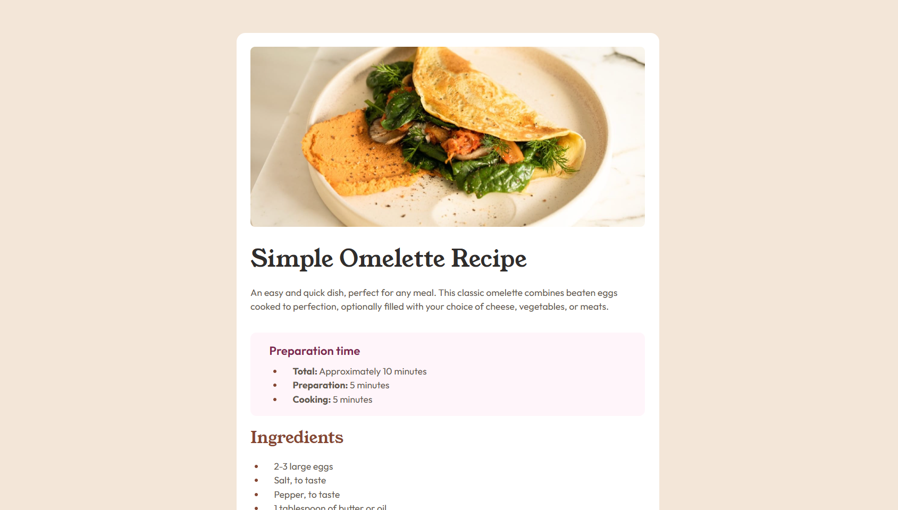
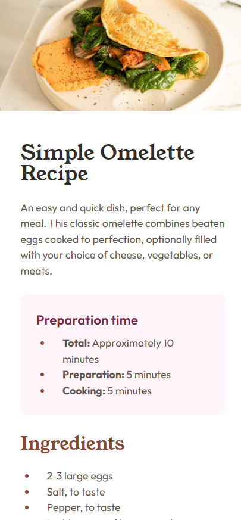

# Frontend Mentor - Recipe page solution

This is my solution to the [Recipe page challenge on Frontend Mentor](https://www.frontendmentor.io/challenges/recipe-page-KiTsR8QQKm). The goal was to build a responsive recipe page as close as possible to the provided desktop and mobile designs.

## Table of contents

- [Overview](#overview)
  - [The challenge](#the-challenge)
  - [Screenshots](#screenshots)
  - [Links](#links)
- [My process](#my-process)
  - [Built with](#built-with)
  - [What I learned](#what-i-learned)
  - [Continued development](#continued-development)
  - [AI collaboration](#ai-collaboration)
- [Author](#author)
- [Acknowledgments](#acknowledgments)

## Overview

### The challenge

Users should be able to:

- View the recipe page at an optimal size for their device.
- Read a clear semantic structure for preparation time, ingredients, instructions, and nutrition information.
- See a layout that closely matches the supplied desktop and mobile references.

### Screenshots

#### Desktop



#### Mobile



### Links

- Repository: [github.com/JesuSaid/Recipe-page](https://github.com/JesuSaid/Recipe-page)
- Live site: To be added after deployment. [jesusaid.github.io/Recipe-page/](https://jesusaid.github.io/Recipe-page/)

## My process

I began by converting the starter content into semantic HTML. After defining the recipe as the main component, I added BEM class names and built the visual styles progressively: local fonts and base layout, card and image styling, typography, section dividers, the nutrition table, and finally the responsive mobile layout.

The work was divided into focused Git commits so each commit represented one meaningful improvement.

### Built with

- Semantic HTML5 markup
- CSS3
- Flexbox
- BEM naming methodology
- Locally hosted fonts with `@font-face`
- Relative units such as `rem`
- CSS logical properties
- Responsive media queries
- Accessible table headers with `scope="row"`

### What I learned

This project helped me understand how semantic HTML improves the meaning and accessibility of a page. For example, the nutrition labels are row headers rather than regular table cells:

```html
<th scope="row">Calories</th>
<td>277kcal</td>
```

I also practiced BEM to describe the relationship between a component, its elements, and its variations:

```html
<section class="recipe__section recipe__section--preparation">
```

Using local font files taught me how to define multiple weights for the same family:

```css
@font-face {
  font-family: Outfit;
  src: url("./assets/fonts/outfit/static/Outfit-SemiBold.ttf");
  font-weight: 600;
  font-style: normal;
  font-display: swap;
}
```

For the mobile layout, I learned that logical properties can keep content and decorative dividers aligned without adding unnecessary HTML:

```css
.recipe__section {
  margin-inline: 2rem;
}
```

### Continued development

In future projects, I want to continue improving:

- Responsive testing across more intermediate viewport sizes.
- CSS custom properties for reusable colors and spacing values.
- Mobile-first styling and progressively enhanced layouts.
- Accessibility testing with keyboard navigation and screen readers.
- Visual comparison and refinement against design references.

### AI collaboration

I used ChatGPT as a learning and code-review partner during this project. It helped me:

- Review semantic HTML and accessibility decisions.
- Understand and correct BEM naming relationships.
- Identify CSS selector, spacing, and responsive-layout issues.
- Plan meaningful Git commit checkpoints and messages.

The implementation decisions and code changes were applied and tested incrementally throughout the project.

## Author

- GitHub: [@JesuSaid](https://github.com/JesuSaid)

## Acknowledgments

Thanks to [Frontend Mentor](https://www.frontendmentor.io/) for providing the challenge, assets, and design references.
